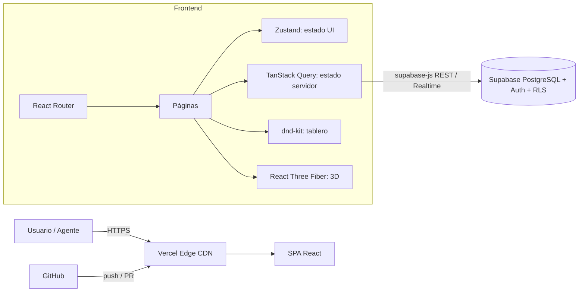

# Caso 01 · ValueDesk
### Sistema web con base de datos orientado a la generación de valor de servicio (ITIL 4)

---

## 1. Contexto del caso

**Organización:** *Grupo Andina Retail*, una empresa mediana con unos 600 colaboradores en 12 sucursales.
**Situación actual:** el soporte de TI se pide por correo, WhatsApp y llamadas. No existe trazabilidad, los
tiempos de respuesta no se miden y la gerencia no sabe cuánto cuesta el soporte ni qué valor entrega.

**Síntomas medidos (línea base):**

| Indicador | Valor actual |
|---|---|
| Tiempo medio de resolución (MTTR) | 31 h |
| Tickets perdidos o duplicados | ~18 % |
| Satisfacción del usuario (CSAT) | 2.9 / 5 |
| Inventario de activos actualizado | No existe |

**Propuesta:** **ValueDesk**, un portal web de soporte interactivo con base de datos SQL. Incluye un
catálogo de servicios, un tablero Kanban de incidentes y solicitudes, KPIs en tiempo real y una base para
gestionar activos.

---

## 2. Arquitectura y justificación tecnológica

| Tecnología | Rol | Justificación (relación con el valor) |
|---|---|---|
| **React** | Librería de UI | Componentes reutilizables y un ecosistema maduro. Al reutilizar piezas se reduce el costo de cambio. |
| **React Router** | Navegación SPA | Rutas declarativas, *code-splitting* por ruta y enlaces profundos (`/tablero`). La navegación es instantánea. |
| **Zustand** | Estado del cliente | Store mínimo, sin *boilerplate*. Guarda solo el estado de UI (menú, filtros) y lo persiste. |
| **TanStack Query** | Estado del servidor | Caché, reintentos, revalidación y **actualizaciones optimistas**: el usuario ve el cambio al instante (utilidad) y, si falla, se revierte (garantía). |
| **dnd-kit** | Interacción arrastrable | Kanban accesible (ratón, táctil y **teclado**), ligero y modular. Visualiza el flujo de valor. |
| **React Three Fiber** | Visualización 3D | Un modelo 3D interactivo que explica el concepto de valor (utilidad ↔ garantía) y refuerza la marca. Se carga diferido para no penalizar el rendimiento. |
| **Supabase** | BD SQL + Auth + Realtime | PostgreSQL gestionado: integridad relacional, **Row Level Security**, backups y API automática. Es *open source*, así que no hay dependencia de un proveedor. |
| **Vercel** | CI/CD y hosting | Cada *push* genera un despliegue y cada PR una **URL de *preview***. CDN global, *rollback* en un clic y HTTPS automático. |

---

## 3. Generación de valor

> **Valor** = la suma de los **beneficios percibidos**, la **utilidad** y la **garantía** de un servicio,
> **co-creado** entre el proveedor y el consumidor.

| Componente | Definición ITIL | Cómo lo entrega ValueDesk |
|---|---|---|
| **Utilidad** (*fit for purpose*) | Lo que hace el servicio | Registro de tickets en menos de 30 s, catálogo con SLA visibles, tablero arrastrable y KPIs vivos. |
| **Garantía** (*fit for use*) | Cómo funciona: disponibilidad, capacidad, seguridad y continuidad | RLS en PostgreSQL, backups de Supabase, CDN de Vercel (99.99 %), *rollback* inmediato y UI optimista con reversión. |
| **Beneficios percibidos** | Lo que siente el usuario | Transparencia del estado, menos frustración, autonomía (autoservicio) y una interfaz clara de alto contraste. |

### Valor para el **cliente** (colaboradores y áreas de negocio)
- Menos tiempo improductivo: la meta es bajar el MTTR de 31 h a **< 8 h**.
- Visibilidad del estado sin tener que llamar a nadie, y SLA conocidos de antemano.
- Acceso desde el celular en sucursal (diseño *mobile-first*).

### Valor para la **empresa** (TI y dirección)
- Datos para decidir: volumen, MTTR, cumplimiento de SLA y CSAT.
- Menor costo por ticket gracias a la automatización y el autoservicio.
- Inventario de activos trazable (fase 2), con menos compras duplicadas.
- Infraestructura *serverless* con costo variable y casi sin operación.

**Resultados y riesgos (co-creación):** el usuario aporta información de calidad al ticket y TI aporta
capacidad de resolución. Se reducen riesgos como la pérdida de solicitudes o los accesos sin control.

---

## 4. Aplicación de los principios guía del SVS

### 4.1 Enfocarse en el valor
- Cada funcionalidad responde a un indicador de la línea base (MTTR, CSAT, tickets perdidos).
- Se priorizó el **tablero** y el **catálogo con SLA** porque atacan los dolores principales. El 3D se
  limita a comunicar el valor y se carga diferido.
- Los KPIs de la portada hacen visible el valor entregado.

### 4.2 Empezar donde se está
- Se parte de lo que ya hay: las categorías actuales de correo/WhatsApp se convierten en el catálogo.
- **Modo demo**: el frontend funciona sin base de datos (datos locales), lo que permite validar con
  usuarios antes de migrar.
- Supabase es PostgreSQL estándar, así que se pueden importar los Excel actuales de inventario por CSV.

### 4.3 Progresar iterativamente con retroalimentación
- Entregas pequeñas: **MVP** (tablero + catálogo), luego autenticación y Realtime, luego activos y CMDB.
- **Vercel**: cada *Pull Request* genera una **URL de *preview*** que se comparte con usuarios clave para
  recibir comentarios *antes* de pasar a producción. El *merge* a `main` despliega solo y, si algo sale mal,
  se hace **rollback instantáneo**. El ciclo de retroalimentación baja de semanas a horas.
- TanStack Query y la UI optimista permiten medir la experiencia real (Web Vitals en Vercel Analytics).

### 4.4 Colaborar y promover la visibilidad
- El tablero Kanban comparte **la misma verdad** entre usuarios, agentes y gerencia.
- Supabase Realtime (fase 2) propaga cambios a todos los clientes al instante.
- Los SLA públicos en el catálogo transparentan los compromisos. Las *previews* de Vercel incluyen al
  negocio en el desarrollo.

### 4.5 Pensar y trabajar de forma holística
Se consideran las **4 dimensiones** de la gestión de servicios:

| Dimensión | Consideración en ValueDesk |
|---|---|
| Organizaciones y personas | Roles (usuario, agente, gerente), capacitación y cultura de registro. |
| Información y tecnología | PostgreSQL relacional, RLS, stack React y accesibilidad. |
| Socios y proveedores | Supabase y Vercel (SLA del proveedor, *exit strategy* gracias a que todo es *open source*/estándar). |
| Flujos de valor y procesos | Gestión de incidentes, cumplimiento de solicitudes, gestión de activos y nivel de servicio. |

---

## 5. Cadena de valor del servicio (mapeo)

| Actividad | En ValueDesk |
|---|---|
| Planificar | Roadmap iterativo y KPIs de línea base |
| Mejorar | Retroalimentación vía *previews* y CSAT |
| Comprometer | Catálogo de servicios con SLA públicos |
| Diseño y transición | PR → *preview* → producción (Vercel) |
| Obtener/Construir | React + Supabase + componentes reutilizables |
| Entregar y soportar | Tablero de incidentes/solicitudes |

---

## 6. Diseño UI/UX aplicado

- **Flat Design:** sin sombras ni degradados. La profundidad se comunica con bordes de 1 px y color sólido
  (el *drag overlay* se pinta en Lime sólido en lugar de llevar sombra). En 3D se usa `meshBasicMaterial`, que no
  responde a luces.
- **Paleta:** fondo `#000000` y acento `#C6FF33`. El texto negro sobre lime tiene un contraste de unos 17:1 (WCAG AAA).
- **Tipografía Sora:** 300 Light (cuerpo), 600 Semibold (subtítulos y etiquetas) y 700 Bold (encabezados).
- **Mobile-first:** columnas apiladas en el celular, 2 en tablet y 3 en laptop (CSS Grid). Menú tipo panel en móvil.
- **Accesibilidad:** foco visible en lime, *drag & drop* con teclado, `aria-*` y `prefers-reduced-motion`.

---

## 7. Mapa del código y Módulos ITSM

| Módulo / Práctica ITIL 4 | Componentes y Hooks | Ruta / Archivos |
|---|---|---|
| **Mesa de Ayuda (Service Desk)** | Tablero Kanban drag & drop, cálculo de SLA en tiempo real, auditoría | `/tablero` · `TicketBoard.jsx`, `useTickets.js` |
| **Catálogo de Servicios** | Búsqueda sin acentos, filtrado por categorías, SLAs visibles y solicitud directa | `/catalogo` · `Catalog.jsx`, `services.js` |
| **Métricas & SLAs (SLM)** | Cumplimiento SLA %, MTTR, tendencias de 7 días, CSAT y exportación CSV | `/metricas` · `MetricsPage.jsx`, `metrics.js`, `csv.js` |
| **Gestión de Activos (ITAM/CMDB)** | Elementos de configuración (laptops, servidores, redes), costos y alertas de garantía | `/activos` · `AssetsPage.jsx`, `useAssets.js` |
| **Habilitación del Cambio (RFC)** | Solicitudes de cambio, evaluación de riesgo, ventanas programadas y plan de reversión | `/cambios` · `ChangesPage.jsx`, `useChanges.js` |
| **Gestión del Conocimiento (KB)** | Artículos de autoservicio, votación de utilidad y sugerencias inteligentes en tickets | `/conocimiento` · `KnowledgePage.jsx`, `useKnowledge.js` |
| **Autenticación & Roles (RBAC)** | Login con credenciales por rol (Usuario, Agente, Gerente), control de accesos y selector rápido | `/login` · `LoginPage.jsx`, `useSessionStore.js`, `permissions.js` |
| **Estilos & UI Flat Design** | Black (`#000000`), Lime (`#C6FF33`), fuente Sora, Flat R3F, 100% libre de emojis | `index.css`, `Layout.css`, `ServiceCube.jsx` |
| **Base de Datos & Despliegue** | Esquema SQL completo con RLS y triggers de SLA, configuración Vercel SPA | `supabase/schema.sql`, `vercel.json` |
